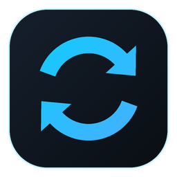

<p align="center"></p>

<h1 align="center">CrossSync</h1>

**Clipboard and file sync between Windows and Android over your local Wi-Fi.** No cloud, no account, no internet needed.

Copy on your phone and paste on your PC, or the other way round. Send files from Explorer's right-click menu or Android's share sheet. Connect several phones to the same PC, and a copy on one phone reaches the PC and every other phone.

| | |
|---|---|
| **Windows app** | WPF · .NET 9 · CommunityToolkit.Mvvm |
| **Android app** | Kotlin · Jetpack Compose · Hilt · Room · WorkManager · Android 8.0+ |
| **Transport** | TLS over TCP on the LAN, with a pairing code and certificate pinning |

---

## Features

### Clipboard
- **Two-way text sync** between the PC and every connected phone, up to 16 MB per copy.
- **Image sync.** Screenshots (Win+Shift+S) and copied images reach the phone ready to paste, and images copied on the phone reach the PC. PNG, JPEG, GIF and BMP are kept as they are; other formats are converted to PNG.
- **Works in the background on Android 10+**, including ChatGPT, Gemini, browsers, text selection, WhatsApp and the system clipboard pop-up. See [How background copy works on Android](#how-background-copy-works-on-android).
- **No echo loops.** A copy received from another device is never sent back.
- **Clipboard history** on the phone, with thumbnails for images.

### Files
- **Windows:** right-click any file → **CrossSync** → choose a phone, or "All connected phones".
- **Android:** use **Share → CrossSync** in any app, then choose the PC and/or other phones.
- **Phone to phone**, relayed through the PC.
- **Checked on arrival.** Every file is verified with SHA-256, transfers can be cancelled from either side, and empty files and duplicate names are handled.
- **Where files land:** `Downloads\CrossSync` on the PC, `Download/CrossSync` on the phone. Tap the "Transfer complete" notification, or the file in the Transfers list, to open it.

### Devices and connection
- **Several phones per PC**, each paired separately and removable at any time.
- **Auto-discovery** of PCs on the network, or enter the PC's IP address.
- **Reconnects on its own** (with backoff), restarts after the phone reboots, and has a Quick Settings tile.
- **Windows:** system tray icon, single instance, optional start with Windows.

---

## Download

Get **`CrossSync.exe`** (Windows, self-contained, no .NET install needed) and **`CrossSync.apk`** (Android) from the [**Releases**](../../releases) page.

GitHub Actions builds every release from the tagged source ([workflow](.github/workflows/release.yml)). Each release also includes `SHA256SUMS.txt` and a signed build-provenance attestation, so you can check that a download is unmodified and was built from this repo:

```bash
gh attestation verify CrossSync.exe --repo Sanket-Baviskar/CrossSync
```

> The exe is not code-signed yet, so Windows SmartScreen will warn you the first time (**More info → Run anyway**). The APK is a signed release build.

---

## Setup

The PC and the phone must be on **the same Wi-Fi network**.

### 1. Windows
1. Put `CrossSync.exe` in a folder it can stay in, for example `C:\CrossSync`. The right-click menu and the startup entry remember this path.
2. Run it.
   - SmartScreen warns about an unknown app: click **More info → Run anyway**.
   - The firewall asks for access: allow it on **Private** networks.
3. The bottom bar shows the PC's **IP address** and a **6-digit pairing code**. Closing the window keeps CrossSync running in the tray.

### 2. Android
1. Install `CrossSync.apk`. Allow installing from unknown sources if asked.
2. Open CrossSync and allow notifications.
3. Tap **Scan** and pick your PC, or enter its IP address in **Settings**.
4. Enter the pairing code shown on the PC. The dashboard then shows **Connected · Encrypted**.

### 3. Background clipboard sync on Android (important)
Android 10+ only lets an app read the clipboard in the background through an accessibility service:

1. **Settings → Apps → CrossSync → ⋮ → Allow restricted settings.** Android 13+ requires this for apps installed outside the Play Store.
2. **Settings → Accessibility → Installed apps → CrossSync 24/7 Clipboard Sync → On.**
3. Recommended: **Apps → CrossSync → Battery → Unrestricted**.
4. **Xiaomi / Redmi / POCO:** under **Other permissions**, allow *Display pop-up windows while running in the background*, and turn on **Autostart**.
   **Vivo / Oppo / Realme:** allow *Pop-up windows* or *Open new windows in background*, and *Auto launch*.
   If the phone blocks a copy, the dashboard shows a warning with a button to the right settings page.

---

## How background copy works on Android

From Android 10, an app that isn't in the foreground gets `null` when it reads the clipboard. CrossSync works around this in two steps:

1. **It detects that a copy happened.** `ClipboardAccessibilityService` watches for any of these signals:
   - a tap on a view labelled *Copy*;
   - a toast or notification saying *Copied* (One UI shows one for every copy);
   - Android 13+'s system clipboard preview (`com.android.systemui:id/clipboard_ui`), which stock Android, Pixel, Motorola, Nothing and others show.

   Both words are also matched in the phone's own language.
2. **It reads the clipboard with focus.** `TransparentClipboardActivity` opens invisibly in its own task for a fraction of a second, reads the clipboard while it has focus, and closes. The app you were using stays in front.

Tested on: Samsung One UI (Android 13 and 17), Motorola (Android 16), and stock Android 12 (emulator). On Android 8–9 background clipboard reads are still allowed, so no workaround is needed.

**Known limitation:** on Android 10–12, an app that copies without showing a *Copy* button or a *Copied* message gives no signal, so that copy is missed.

---

## Security model

- **Encrypted.** All traffic is TLS. The PC's certificate is created on first run and stays on that PC.
- **Pinned.** The phone pins the PC by its certificate fingerprint, and both apps show the fingerprint so you can compare them.
- **Paired.** A phone connects only after entering a 6-digit, single-use pairing code. After that it uses a per-device token, of which the PC stores only a SHA-256 hash.
- **Guarded against floods.** Repeated failed handshakes from one IP are throttled. Every message type has a size limit, and received file names are sanitised.
- **Local only.** Nothing leaves your LAN. There is no server, telemetry or account.

Release APKs are signed and shrunk/obfuscated with R8. Still to do: Authenticode signing for the Windows exe.

---

## Building from source

### Windows app
Requires the [.NET 9 SDK](https://dotnet.microsoft.com/download) on Windows.

```powershell
cd windows
dotnet build -c Release
# Self-contained single-file exe:
dotnet publish src/ClipWindows/ClipWindows.csproj -c Release -r win-x64 --self-contained `
  -p:PublishSingleFile=true -p:EnableCompressionInSingleFile=true -p:IncludeNativeLibrariesForSelfExtract=true
```

The exe is created as `CrossSync.exe` in `windows/src/ClipWindows/bin/Release/net9.0-windows/win-x64/publish/`.

### Android app
Requires JDK 17 and the Android SDK (compileSdk 35). Android Studio provides both.

```bash
cd android
./gradlew assembleDebug        # Windows: gradlew.bat assembleDebug
```

The APK is created at `android/app/build/outputs/apk/debug/app-debug.apk`.

**Signed release build** (shrunk and obfuscated with R8):

1. Create a keystore once, keeping it outside the repo. The `keytool` command is in [`android/keystore.properties.example`](android/keystore.properties.example).
2. Copy `keystore.properties.example` to `android/keystore.properties` and fill in the path and passwords. Git ignores this file.
3. Build it:
   ```bash
   ./gradlew assembleRelease
   ```
   The APK is created at `android/app/build/outputs/apk/release/app-release.apk`.

Without `keystore.properties`, the release APK is built unsigned. Back up the keystore and its password: every future update must be signed with the same key.

---

## Project structure

```
CrossSync/
├── windows/                     # PC app (hub)
│   └── src/ClipWindows/
│       ├── Network/             # TLS server, multi-phone hub, discovery, certificate
│       ├── Protocol/            # Frame header, message types, limits
│       ├── Services/            # Clipboard monitor, settings, Explorer context menu
│       ├── ViewModels/          # MainViewModel (MVVM)
│       └── Views/               # Main window, device picker
├── android/                     # Phone app
│   └── app/src/main/java/com/crosssync/app/
│       ├── service/             # Connection service, accessibility service, boot receiver
│       ├── protocol/            # Frame header, message types, TLS
│       ├── ui/                  # Compose screens, share target, clipboard trampoline
│       ├── data/                # Room DB, repositories, settings
│       └── utils/               # Clipboard, downloads, notifications, file opener
├── docs/
│   └── PROTOCOL.md              # Wire protocol specification
├── tools/make_icon.py           # Generates the app icon
└── .github/workflows/release.yml  # Builds and publishes releases on version tags
```

The wire format, handshake and pairing are documented in [docs/PROTOCOL.md](docs/PROTOCOL.md).

---

## Roadmap

- [x] Release signing (APK)
- [ ] Code signing (exe)
- [ ] Send whole folders from the Explorer menu
- [ ] Windows 11 modern context menu (needs MSIX packaging)
- [ ] Show which phone a relayed clip or file came from
- [ ] Keep the PC's clipboard history after a restart

## License

Copyright © 2026 Sanket Baviskar

CrossSync is free software. You can redistribute it and/or modify it under the terms of the
[GNU General Public License v3.0](LICENSE) or (at your option) any later version.
It is distributed WITHOUT ANY WARRANTY; see the license for details.
